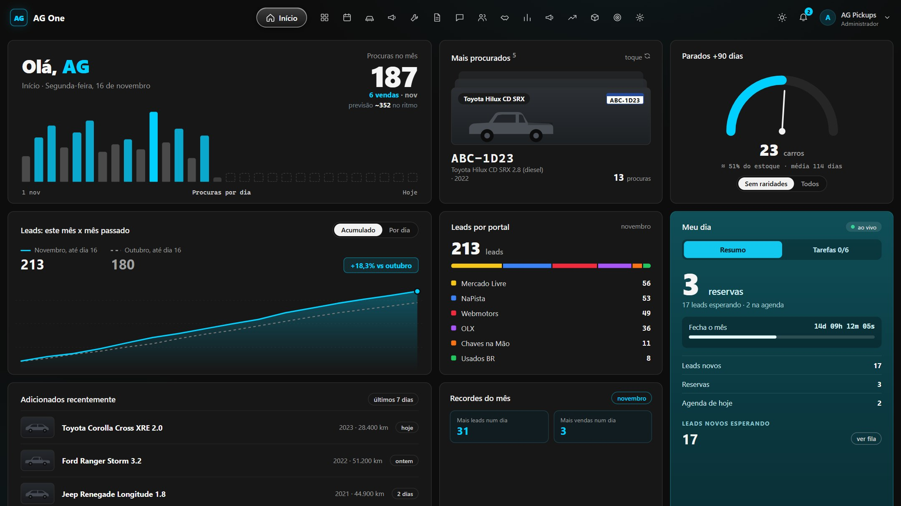

# Portfólio — Silas Ribeiro

Página: **https://silasfribeiro.github.io**

Aplicações com IA, nascidas de um problema real. Aqui estão o AG One (ecossistema de gestão automotiva), o Orbi, o Verbo Vivo e a simulação do Yume.

- [A página do portfólio](https://silasfribeiro.github.io) (`index.html`)
- [A simulação do Yume](https://silasfribeiro.github.io/yume-demo/index.html) (`yume-demo/`), com dados inventados; nada é salvo
- [As imagens](img) (`img/`): capturas das páginas públicas e telas reconstruídas

As telas do AG One e do Yume são **reconstruções com dados fictícios**: nenhum dado real da loja ou de clientes é exibido. O código do AG One é privado.
